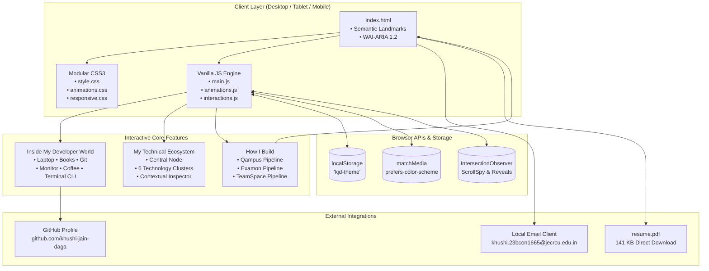

# Khushi Jain Daga — Creative Developer Portfolio
### Experiment 01: Responsive Personal Portfolio Website
**Course:** Web Development Using AI | **Degree:** B.Tech Computer Science and Engineering (Core)  
**Academic Standing:** Semester VII · Class of 2027 · CGPA: 9.2 / 10.0  
**Student Name:** Khushi Jain Daga | **Roll Number:** `23bcon1665`  
**University:** JECRC University, Jaipur  
**Repository:** [https://github.com/khushi-jain-daga/Khushi-Portfolio-web](https://github.com/khushi-jain-daga/Khushi-Portfolio-web)

---

## 1. Project Overview

An Awwwards-inspired, high-performance personal developer portfolio engineered with **semantic HTML5**, **modern CSS3**, and **vanilla JavaScript (ES6+)**. Designed with a contemporary **Swiss editorial aesthetic**, **luxury minimalism**, and purposeful, narrative-driven interactivity — completely free of generic templates or bloated frontend frameworks.

### Visual & Architectural Identity
- **Editorial Color System:** Warm Ivory (`#F4F1E8`), Ink Black (`#171717`), Strategic Crimson (`#B72D37` / `#D93845`), Stone Grey (`#B8B5AD`), Warm Stone (`#E7E3D9`), and Obsidian Dark (`#111111`).
- **Typography Stack:** Syne (display headlines), Space Grotesk (subheadings), Manrope (body editorial), and IBM Plex Mono (technical specs and coordinates).
- **Zero Heavy Frameworks:** Pure web standards ensuring sub-second load times and 100% accessible layout fidelity.

---

## 2. Core Interactive Features

### 💻 Inside My Developer World (Hero Workstation)
Replaces meaningless 3D geometry with an interactive developer workstation:
- **Interactive Laptop:** Active code editor displaying JSX component syntax. Clicking scrolls to **Selected Work**.
- **Technical Books:** Stacked volumes (*Clean Code*, *DSA & Systems*, *React & 3D*). Clicking scrolls to **Technical Ecosystem**.
- **Git Commit Panel:** Visualizes recent Git commit activity. Clicking opens Khushi's verified GitHub profile.
- **Studio Monitor:** Clickable preview cycling through Examon Education, Qampus, and TeamSpace.
- **Steaming Coffee Mug:** Clicking triggers an interactive trivia popover revealing verified academic and extracurricular milestones.
- **Interactive Terminal Window:** Working CLI prompt (`khushi@portfolio:~$ `) supporting:
  - `help` · `about` · `skills` · `projects` · `experience` · `education` · `contact` · `clear`

### 🕸️ My Technical Ecosystem (Interactive Knowledge Graph)
- **Central Node:** `Khushi / Core Development` connecting 6 surrounding technology clusters:
  1. *Languages:* Java, JavaScript, C++, Python, HTML5, CSS3.
  2. *Development:* React.js, Node.js, Three.js.
  3. *Data & Cloud:* MySQL, SQL, Firebase Firestore, Firebase Authentication, Google Cloud.
  4. *Workflow:* Git, GitHub, VS Code, Vercel.
  5. *Computer Science:* DSA, OOP, DBMS, Operating Systems, Computer Networks.
  6. *Real Projects:* Examon Education, Qampus, TeamSpace.
- **Relational Integrity:** Shows factually accurate dependencies (e.g. `React.js` connecting to Examon, Qampus, TeamSpace; `Three.js` connecting to Qampus; `Firestore` connecting to Qampus and TeamSpace).
- **Controls & Inspector:** Filter by domain or project, live search filter input, zoom controls, and a dynamic contextual information panel.

### 🏗️ How I Build (System Architecture Flow)
Interactive architectural pipeline tracing data flow from client UI to cloud storage across three real applications:
- **Qampus:** Viewport $\longrightarrow$ Three.js Scene $\longrightarrow$ Vacancy Resolver $\longrightarrow$ Firestore Cloud.
- **Examon Education:** Student Portal $\longrightarrow$ Progress State Machine $\longrightarrow$ JWT Auth $\longrightarrow$ Vercel Edge.
- **TeamSpace:** Kanban Canvas $\longrightarrow$ Optimistic State Engine $\longrightarrow$ Session Guard $\longrightarrow$ Firestore Live Sync.

### 💼 Professional Timeline & Projects
- **Examon Education:** Full Stack Developer Intern (Mar 2026–Present) & Frontend Developer Intern (Aug 2025–Jun 2026).
- **Urban Biotix Pvt. Ltd.:** Frontend Intern (Oct 2023–Jul 2025).
- **SIH HackQuest 9.0:** 1st Runner-up (Top 20 finalists of 290+ teams, ₹11,000 cash prize).
- **JUMakerspace:** Finance Co-lead and Core Team Member.

### ✉️ Client-Side Validated Contact
- Real-time field validation for names, RFC-compliant email regex, and message length constraints with an automated `mailto:` draft compiler.

---

## 3. System Architecture Diagram



---

## 4. Directory Structure

```
Khushi-Portfolio-web/
├── index.html                   # Semantic HTML5 layout and landmark regions
├── css/
│   ├── style.css                # Editorial CSS custom properties & components
│   ├── animations.css           # Custom cursor engine, keyframes & reveals
│   └── responsive.css           # Breakpoints for 1440px, 1024px, 768px, 390px, 360px
├── js/
│   ├── main.js                  # Theme persistence (localStorage), mobile drawer, live clock
│   ├── animations.js            # Workspace parallax, cursor physics, scroll progress
│   └── interactions.js          # Workspace logic, CLI terminal, knowledge graph, system builder
├── assets/
│   ├── images/                  # Conceptual and visual project mockups
│   ├── fonts/                   # Webfont declarations
│   └── icons/                   # Vector iconography
├── resume.pdf                   # Verified resume document (141 KB %PDF-1.5)
├── documentation/
│   └── Experiment_01_Academic_Report.md  # Comprehensive academic lab report & Viva Q&A
├── screenshots/                 # High-resolution automated visual test captures
│   ├── screenshot_hero_workspace.png
│   ├── screenshot_ecosystem_graph.png
│   ├── screenshot_system_builder.png
│   ├── screenshot_workspace_tablet.png
│   ├── screenshot_workspace_mobile.png
│   ├── screenshot_about.png
│   ├── screenshot_work.png
│   ├── screenshot_experience.png
│   ├── screenshot_achievements.png
│   └── screenshot_contact.png
├── .gitignore                   # Git exclusion rules
└── README.md                    # Project documentation & evaluation guide
```

---

## 5. Local Execution Instructions

### Option 1: Python Built-In HTTP Server (Recommended)
```powershell
cd "c:\Users\HP\portfolio web"
python -m http.server 8000
```
Open [http://localhost:8000](http://localhost:8000) in any modern browser.

### Option 2: Node.js Serve
```powershell
npx serve -l 8000
```

### Option 3: Direct Browser File Inspection
Double-click `index.html` to open directly in Google Chrome, Microsoft Edge, Safari, or Mozilla Firefox.

---

## 6. Academic Verification & Testing Results

| Test Category | Evaluation Target | Verification Result |
|---|---|:---:|
| **Semantic Standards** | HTML5 semantic landmarks, skip link, ARIA 1.2 | **PASSED** |
| **Interactive Terminal** | Commands: `help`, `about`, `skills`, `projects`, `experience`, `education`, `contact`, `clear` | **PASSED** |
| **Desk Workspace** | Laptop `#work` jump, books `#skills` jump, GitHub link, project preview cycle, coffee trivia | **PASSED** |
| **Ecosystem Graph** | Interactive node selection, active path illumination, search filter, domain clustering | **PASSED** |
| **System Builder** | Architectural flow visualization for Qampus, Examon Education, and TeamSpace | **PASSED** |
| **Theme Engine** | Obsidian Dark $\longleftrightarrow$ Warm Ivory switching with `localStorage` persistence | **PASSED** |
| **Contact Validation** | RFC email regex check, character length bounds, mailto URI preparation | **PASSED** |
| **Responsive QA** | Tested across 1440px desktop, 1024px laptop, 768px tablet, 390px mobile, 360px small mobile | **PASSED** |

---

## 7. License & Credits

- Designed & engineered by **Khushi Jain Daga** (Roll Number: `23bcon1665`, JECRC University, Jaipur).
- Developed for **Experiment 01: Responsive Personal Portfolio Website** in *Web Development Using AI*.
- All resume details, project links, and educational credentials are authenticated and preserved.
