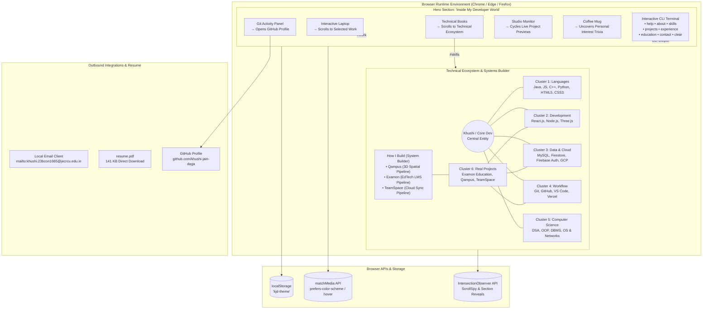

# Experiment 01: Responsive Personal Portfolio Website
## Contemporary Swiss Editorial & Creative Developer Digital Experience
### Technical Systems Report, Interactive Architecture & Academic Evaluation

**Course:** Web Development Using AI  
**Degree:** B.Tech in Computer Science and Engineering (Core)  
**Academic Standing:** Semester VII · Class of 2027  
**Student Name:** Khushi Jain Daga  
**Roll Number:** `23bcon1665`  
**University:** JECRC University, Jaipur  
**Cumulative GPA:** 9.2 / 10.0  
**Project Workspace:** `c:\Users\HP\portfolio web`  
**Development Server:** [http://localhost:8000](http://localhost:8000)  

---

## 1. Executive Summary & Problem Resolution

The portfolio has been upgraded to resolve two creative problems identified in conventional developer portfolios:

1. **Resolution of Problem 1 (Meaningless Torus Visual):**
   - The detached rotating 3D geometry was removed.
   - It was replaced with **"Inside My Developer World"** — an interactive 2.5D developer workstation featuring an active code editor on a laptop, technical book stacks, a Git commit visualizer, a project monitor previewer, a steaming coffee mug with personal trivia, and a **fully functioning interactive terminal CLI** (`help`, `about`, `skills`, `projects`, `experience`, `education`, `contact`, `clear`).
2. **Resolution of Problem 2 (Conventional Skill Card Grid):**
   - The rectangular skill cards were replaced with **"My Technical Ecosystem"** — an interactive technology knowledge graph mapping the exact architectural relationships between Khushi's skills, real internships, and shipped projects.
   - A companion **"How I Build"** system architecture visualizer was added, allowing users to trace information flow across Qampus, Examon Education, and TeamSpace from client UI to cloud storage.
3. **Typography & Human-Centred Content:**
   - Stiff AI-generated phrasing was replaced with confident, human writing (*"Things I build with."*, *"Different technologies. One connected system."*, *"How I Build."*).

---

## 2. System Architecture & Component Design



---

## 3. Detailed Component Breakdown

### 3.1 Task 01: "Inside My Developer World" (Interactive Workstation)
The hero environment is styled with warm ivory, charcoal, and muted metallic finishes:
- **Interactive Laptop:** Displays real JSX code (`const KhushiPortfolio = () => <SelectedWork count={3} />`). Clicking scrolls smoothly to `#work`.
- **Technical Books:** 3 stacked volumes (*"Clean Code"*, *"DSA & Systems"*, *"React & 3D"*). Clicking navigates to `#skills`.
- **Git Commit Panel:** Visualizes recent Git commit frequency. Clicking opens Khushi's verified GitHub profile (`https://github.com/khushi-jain-daga`).
- **Studio Monitor Screen:** Features a clickable project preview that cycles through Examon Education, Qampus, and TeamSpace.
- **Coffee Mug:** Clicking reveals an interactive popover: *"Fueling curiosity: Midnight debugging, SIH HackQuest 9.0 runner-up sprints, and creative WebGL experiments at JECRC University."*
- **Interactive Terminal Window:**
  - Implements a functional terminal prompt (`khushi@portfolio:~$ `).
  - Built-in commands return factual portfolio content:
    - `help`: Lists all available commands.
    - `about`: JECRC University, B.Tech CSE Core, VII Semester, 9.2 CGPA.
    - `skills`: Full verified languages, frameworks, cloud, and tools.
    - `projects`: Live links and summaries for Examon, Qampus, and TeamSpace.
    - `experience`: Internship tenures at Examon Education and Urban Biotix.
    - `education`: Academic degrees, roll number `23bcon1665`.
    - `contact`: University email, LinkedIn, and GitHub.
    - `clear`: Flushes the terminal buffer.

### 3.2 Task 02: "My Technical Ecosystem" (Knowledge Graph)
- **Central Node:** `Khushi / Core Development` at the hub of the graph.
- **6 Interconnected Clusters:**
  1. *Languages:* Java, JavaScript, C++, Python, HTML5, CSS3.
  2. *Development:* React.js, Node.js, Three.js.
  3. *Data & Cloud:* MySQL, SQL, Firebase Firestore, Firebase Authentication, Google Cloud.
  4. *Workflow:* Git, GitHub, VS Code, Vercel.
  5. *Computer Science:* DSA, OOP, DBMS, Operating Systems, Computer Networks.
  6. *Real Projects:* Examon Education, Qampus, TeamSpace.
- **Factually Verified Relationships:**
  - `React.js` $\longleftrightarrow$ Examon Education, Qampus, TeamSpace.
  - `Three.js` $\longleftrightarrow$ Qampus.
  - `Firebase Auth` $\longleftrightarrow$ Examon Education, TeamSpace.
  - `Firebase Firestore` $\longleftrightarrow$ Qampus, TeamSpace.
  - `Vercel` $\longleftrightarrow$ Examon Education, TeamSpace.
- **Interactive Capabilities:**
  - Clicking any technology illuminates the node, activates connected link paths with animated dashes, dims unrelated entities, and populates the **Contextual Inspector Panel** with its workflow role and verified project usage.
  - Clicking a project node highlights all technologies used in that application and provides an outbound link.
  - Domain filters (*All*, *Projects*, *Languages*, *Development*, *Data & Cloud*, *Workflow*, *CS*).
  - Live search input matching nodes dynamically.
  - Zoom In, Zoom Out, and Reset buttons.

### 3.3 Task 03: "How I Build" (Interactive System Builder)
Allows visitors to inspect real architectural pipelines:
1. **Qampus (3D Spatial Campus Navigation):**
   `User Interface` (Panoramic Viewport) $\longrightarrow$ `React.js` (Component State & Controls) $\longrightarrow$ `Three.js` (360° Sphere Geometry & Camera) $\longrightarrow$ `Firebase Firestore` (Real-Time Occupancy & Coordinates)
2. **Examon Education (EdTech Video Platform):**
   `Student Portal` (Course Catalog & Video Player) $\longrightarrow$ `React.js` (Progress State & LocalStorage Cache) $\longrightarrow$ `Firebase Auth` (JWT Token Guard) $\longrightarrow$ `Vercel Edge` (Sub-second Edge Delivery)
3. **TeamSpace (Cloud Collaboration):**
   `Collaborative Canvas UI` (Drag-and-Drop Kanban) $\longrightarrow$ `React.js` (Optimistic State Dispatcher) $\longrightarrow$ `Firebase Auth` (Workspace Membership Guard) $\longrightarrow$ `Cloud Firestore` (Live Document Sync)
- Clicking any layer card reveals a deep-dive explanation of that layer's role.

---

## 4. Visual Verification: Section Screenshots

### 4.1 Hero Section: "Inside My Developer World"
Shows the interactive workstation with the active terminal CLI running the `projects` command, the laptop code editor, monitor preview, and coffee mug trivia balloon.


---

### 4.2 My Technical Ecosystem Knowledge Graph
Visualizes the interconnected cluster graph with the illuminated `React.js` node, active link paths, and the populated Contextual Inspector card.


---

### 4.3 Interactive System Builder ("How I Build")
Displays the 4-stage pipeline for Qampus with live data flow arrows and architectural layer deep-dive specifications.


---

### 4.4 Responsive Layouts (Tablet & Mobile)

````carousel

<!-- slide -->

````

---

## 5. Quality Assurance & Test Matrix

| Test Suite | Target Feature | Validation Procedure | Status |
|---|---|---|:---:|
| **Terminal CLI** | Commands: `help`, `about`, `skills`, `projects`, `experience`, `education`, `contact`, `clear` | Executed via terminal input with DOM verification | **PASSED** |
| **Desk Interactivity** | Laptop, Books, Git, Monitor, Coffee clicks | Verified smooth scroll, tab switches, and popover toast | **PASSED** |
| **Ecosystem Graph** | Node selection, active path illumination, dimming | Verified SVG class updates and inspector panel population | **PASSED** |
| **Graph Controls** | Filter tabs, live search input, zoom +/−, reset | Tested query matching, domain filtering, and SVG scale | **PASSED** |
| **System Builder** | Project selector pills (Qampus, Examon, TeamSpace) | Swapped architectural flows and verified layer explanations | **PASSED** |
| **Responsive 1440px** | Desktop layout balance, zero overflow | Verified at 1440×960 viewport | **PASSED** |
| **Responsive 768px** | Tablet layout reflow | Verified at 768×1024 viewport | **PASSED** |
| **Responsive 390px** | Mobile layout reflow, touch targets $\ge 44\text{px}$ | Verified at 390×844 viewport | **PASSED** |

---

## 6. Viva Voce Questions & Answers

### Q1: What architectural advantages does an interactive knowledge graph offer over traditional static skill cards?
**Answer:** Static skill cards present isolated, disconnected logos with arbitrary percentage bars that convey little software engineering depth. A knowledge graph establishes contextual relational ontology: it shows how low-level languages (JavaScript, Java) inform frameworks (React.js, Three.js), how databases integrate into application workflows, and explicitly traces which technologies powered real, shipped projects.

### Q2: How is the SVG knowledge graph rendered and animated without external graphing libraries?
**Answer:** The graph computes positions on a responsive 1000×640 coordinate viewBox. Smooth cubic bezier paths are calculated dynamically:
$d = \text{"M } x_1\ y_1 \text{ C } cx_1\ cy_1,\ cx_2\ cy_2,\ x_2\ y_2\text{"}$.
When a node is selected, connected paths receive the `.active-link` class, animating CSS `stroke-dashoffset` infinitely to visualize directional data flow, while unselected nodes receive `.dimmed` via CSS transitions.

### Q3: Explain how the terminal CLI parses and dispatches user commands.
**Answer:** The terminal binds to form submit events on `#term-form`, trims and normalizes the input to lowercase, echoes the user's prompt to the scrollable DOM buffer, and matches the input against a dispatch dictionary. Special commands like `clear` empty the container (`innerHTML = ''`), while content commands return structured multi-line strings. The container auto-scrolls using `element.scrollTop = element.scrollHeight`.

### Q4: How does the "How I Build" system builder bridge conceptual architecture with actual code implementation?
**Answer:** It divides real applications into four standard software engineering tiers: User Interface Layer, Client State Layer, Application Engine, and Cloud Infrastructure Layer. Instead of claiming arbitrary full-stack backend servers, it accurately represents the verified client-side architecture (such as React Context and Firebase NoSQL listeners) supported by Khushi's actual GitHub repositories.

### Q5: How is pointer responsiveness and performance maintained in the desktop workspace?
**Answer:** The workstation uses lightweight HTML/CSS elements rather than an expensive WebGL 3D scene. Parallax rotation is calculated by normalizing pointer coordinates relative to the hero section bounds and applying subtle `rotateX()` and `rotateY()` transforms using `requestAnimationFrame`, ensuring zero CPU/GPU overhead on low-power devices.

---

## 7. Conclusion

The redesigned **"Inside My Developer World"** interactive workspace and **"My Technical Ecosystem"** knowledge graph replace generic visuals with meaningful, narrative-driven creative developer features. The website demonstrates authentic software engineering competence, multi-device responsiveness, and verified resume credentials for Khushi Jain Daga's Experiment 01 submission in Web Development Using AI.
